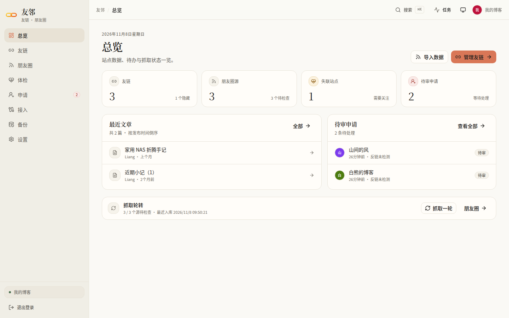
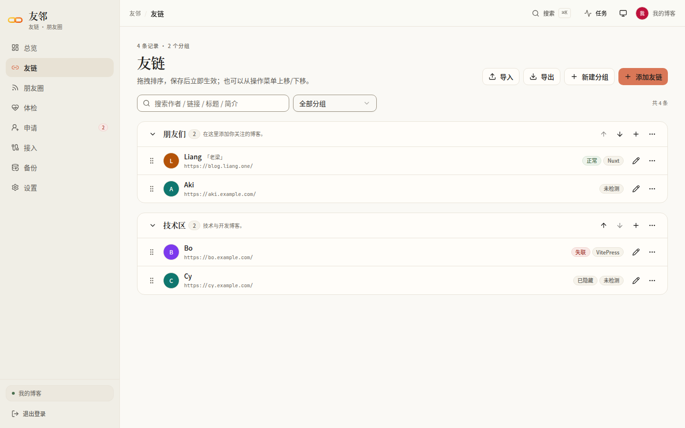
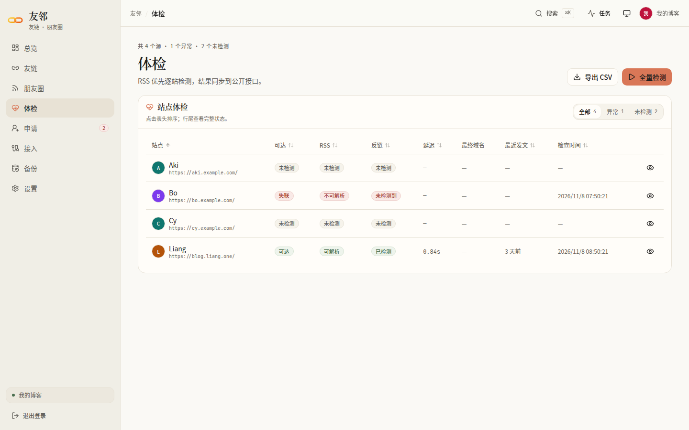
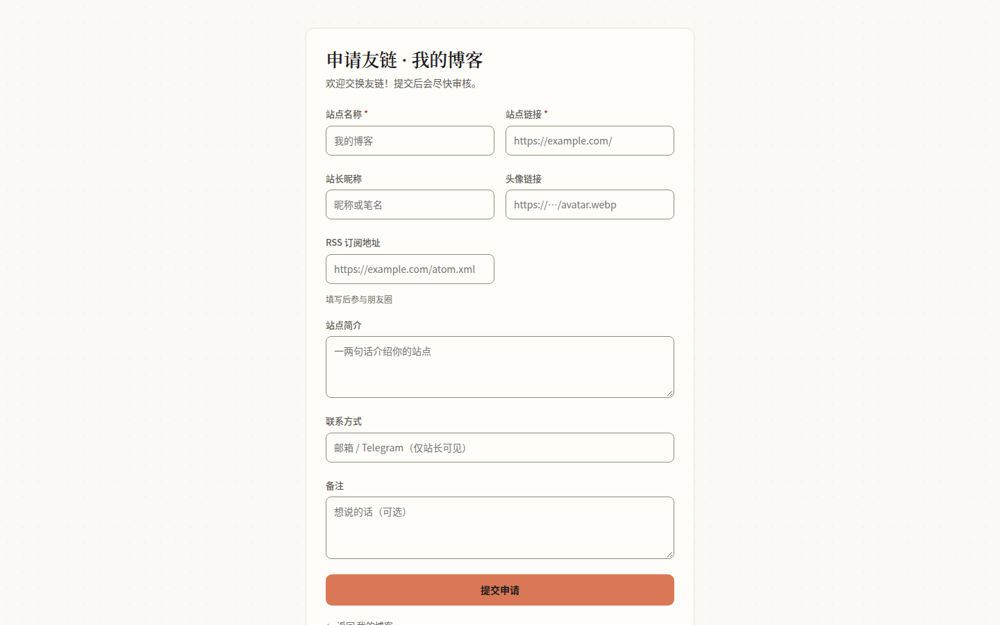

# 友邻 Youlin

[](https://github.com/lmb666666/youlin/actions/workflows/ci.yml)
[](https://github.com/lmb666666/youlin/actions/workflows/docker.yml)
[](https://github.com/lmb666666/youlin/releases)
[](LICENSE)

**自托管的友链与朋友圈管理台。** 一个 Docker 容器、一份 SQLite 数据，跑在自己的服务器上；博客端只需要 fetch 两个数据接口，申请页可以直接外链，不用安装任何东西。

> **生产部署自 v0.4.0 起为 Docker-only。** Cloudflare Workers 支持已在 v0.3.0 归档，见[归档说明](docs/archive/workers.md)。

<details>
<summary><b>界面预览 | Screenshots</b>（点击展开）</summary>

### 总览

<picture>
  <source media="(prefers-color-scheme: dark)" srcset="docs/images/admin-dashboard-dark.png">
  
</picture>

### 友链

<picture>
  <source media="(prefers-color-scheme: dark)" srcset="docs/images/admin-links-dark.png">
  
</picture>

### 体检

<picture>
  <source media="(prefers-color-scheme: dark)" srcset="docs/images/admin-health-dark.png">
  
</picture>

### 申请页（访客侧）

<picture>
  <source media="(prefers-color-scheme: dark)" srcset="docs/images/apply-dark.png">
  
</picture>

更多截图（朋友圈、接入、设置、明暗两套）在 [`docs/images/`](docs/images/)。

</details>

## 为什么 | Why

以前加友链要改数据文件、提交、等构建；朋友圈要单独维护爬虫；友链申请散落在评论区；站点挂了没人知道。友邻把这些收进一个网页：友链、分组、体检、朋友圈、申请队列、备份都在同一个管理台里。

- **不绑博客系统**：Hexo、Hugo、WordPress、自建前端一视同仁，只通过 HTTP 接口取数据。
- **数据在自己手里**：单容器 + SQLite，一块数据卷就是全部数据；备份是普通的 `.json.gz` 文件。
- **单租户、可自托管**：一个实例服务一个站点，MIT 开源，没有账号体系与云依赖。

## 特色 | Features

- **友链**：增删改、分组、拖拽排序、隐藏、搜索；支持从任意 JSON 批量导入，导出 JSON / CSV / OPML。
- **自动探测**：填好站点地址后点「自动探测」，自动补全 RSS、站点标题、favicon 与头像建议。
- **体检**：定期检查可达性、延迟、RSS 可用性、反链与最近发文；失联源按阶梯退避，结果可导出 CSV。
- **朋友圈**：定时分批抓取 RSS/Atom/RDF/JSON Feed，条件请求减少重复下载；抓取状态页可手动触发单个源或全量。
- **申请**：内置公开申请页，支持 Turnstile、每 IP 每日限流、反链检测；通过后自动入库。
- **备份**：完整备份含分组、友链、申请与设置；可下载 `.json.gz`，也可配置 WebDAV 自动上传与云端恢复。
- **管理台**：`⌘K` 命令面板、URL 状态、全局任务进度、明暗主题、移动端抽屉；设置页由配置 schema 自动生成。

## 快速开始 | Quick Start

### Docker（推荐）

要求 Docker 24+ 与 Docker Compose v2；镜像同时提供 amd64 / arm64。

```bash
git clone https://github.com/lmb666666/youlin.git
cd youlin
cp .env.example .env
# 编辑 .env，至少填写 ADMIN_TOKEN：
#   openssl rand -hex 32
docker compose up -d
```

验证并登录：

```bash
docker compose ps
curl -fsS http://127.0.0.1:8787/healthz
# 浏览器打开 http://127.0.0.1:8787/admin
```

首次登录后建议先到「设置」填写站点名称、主站地址、时区，并检查申请页与备份配置。Compose 默认只把端口绑到 `127.0.0.1`，远程访问请通过反向代理，见[部署指南](docs/deployment.md)。

> 生产环境建议把 Compose 里的 `:latest` 换成具体版本（如 `:0.4.0`）或 digest，升级与回滚更可控。

### 本地开发

需要 Node.js ≥ 24 与 pnpm。数据库是本地 SQLite 文件，不需要 Docker。

```bash
pnpm install
cp .env.example .env      # 本地口令随便填
pnpm build                # 生成 web/dist（首次或改前端后）
pnpm seed                 # 可选：应用迁移并写入示例数据
pnpm dev                  # http://127.0.0.1:8787/admin
```

前端热更新另开终端跑 `pnpm dev:web`（只代理 `/api`）。完整开发约定见[贡献指南](CONTRIBUTING.md)。

## 架构 | Architecture

```text
浏览器 / 接入方
      │
      ▼
Caddy / Nginx（可选，HTTPS）
      │
      ▼
Node 24 容器 ──────────────────────────────────────────────
  Hono 路由
    ├─ /admin          管理台 SPA（React + Vite）
    ├─ /api/links      友链数据
    ├─ /api/circle     朋友圈
    ├─ /apply          申请页 + 提交
    └─ /healthz        健康检查
  进程内调度器
    ├─ 分批抓取 / 体检轮转
    ├─ 每日文章清理
    └─ WebDAV 自动备份检查
      │
      ▼
/data/youlin.db（SQLite + WAL，命名卷）
```

生产部署是**单实例**：SQLite 单写者，不要同时起多个副本挂同一个数据卷；调度器有数据库锁兜底，但不构成多副本方案。分层、数据模型与请求流程见[架构说明](docs/architecture.md)。

## 接口 | API

对外只有三条业务路径，加上一个运维探针：

| 接口 | 端点 | 用途 |
| --- | --- | --- |
| 友链数据 | `GET /api/links` | 分组 + 友链 + 体检摘要；可选 `?group=` |
| 朋友圈 | `GET /api/circle` | 文章列表与统计；可选 `?limit=` |
| 友链申请 | `GET /apply`、`POST /apply` | 申请页与提交 |
| 健康检查 | `GET /healthz` | 数据库可达性，供监控使用 |

默认 CORS 全开、`Cache-Control: public, max-age=300`；时间统一 ISO 8601 UTC，字段为 camelCase。字段、参数、错误码与 `health` 的 null 语义见[接口文档](docs/api.md)。

```js
const { groups } = await (await fetch('https://links.example.com/api/links')).json()
for (const group of groups) {
  for (const link of group.links) {
    // link.author / link.link / link.avatar / link.health …
  }
}
```

## 升级与备份 | Upgrade & Backup

升级前先在「备份」页下载一份完整备份：

```bash
docker compose pull
docker compose up -d
```

启动时自动应用增量迁移；迁移失败会阻止服务启动。项目不提供 down migration，回滚需要恢复备份或换回旧镜像。备份格式、WebDAV 自动上传、覆盖式恢复与实例迁移见[备份与恢复](docs/backup.md)。

## 安全 | Security

- `ADMIN_TOKEN` 同时是登录口令和会话签名密钥；请使用足够长的随机串，轮换后所有会话立即失效。
- 通过 HTTPS 暴露管理台；反向代理要正确设置 `X-Forwarded-Proto`，并按部署方式配置 `TRUST_PROXY`。
- 不要把 `.env`、数据库或备份文件提交到仓库；备份包含申请人的联系方式与备注，且默认不加密。
- WebDAV 建议使用 HTTPS；HTTP WebDAV 会让 Basic 认证凭据以明文传输。
- 镜像默认以非 root、只读根文件系统、`cap_drop: ALL`、`no-new-privileges` 运行。

完整清单与漏洞报告方式见[SECURITY.md](SECURITY.md)。

## 开发与测试 | Development & Testing

| 命令 | 说明 |
| --- | --- |
| `pnpm dev` | Node 服务 + 本地 SQLite（需先 `pnpm build`） |
| `pnpm dev:web` | 管理台 Vite 开发服务器（热更新） |
| `pnpm build` | 构建管理台（`web/dist`） |
| `pnpm build:server` | 构建服务端单文件（`server/dist/main.mjs`） |
| `pnpm test` | Node 服务端测试 + 前端测试 |
| `pnpm test:web` | 只跑前端测试 |
| `pnpm lint` / `pnpm typecheck` | ESLint / 两端类型检查 |
| `pnpm docs:config` | 重新生成配置参考表格 |

CI 还会校验版本一致性、生产依赖审计、配置文档漂移，并构建 Docker 镜像做容器烟测。提交与 PR 约定见[贡献指南](CONTRIBUTING.md)。

## 常见问题 | FAQ

| 现象 | 处理 |
| --- | --- |
| 登录 401 / 口令不对 | 检查 `.env` 的 `ADMIN_TOKEN`；修改后需要 `docker compose up -d` 重建容器 |
| 申请页提示未开放 / 人机验证未配置 | 检查 `apply.enabled`、`apply.turnstile` 与 `TURNSTILE_SECRET` |
| 朋友圈一直为空 | 友链需要填写 `feed`；在友链编辑里点「自动探测」补全，再手动抓取一轮 |
| 接口还是旧数据 | 接口默认缓存 5 分钟；可在设置里调整 `api.cacheSeconds` |
| 容器起来了但打不开 | 先看 `docker compose ps` 与 `docker compose logs`；默认只绑 `127.0.0.1`，远程要配反向代理 |

更多故障排查见[部署指南 § 故障排查](docs/deployment.md#故障排查--troubleshooting)。

## 从 Workers 迁移 | Migrating from Workers

v0.3.0 是最后一个 Workers 版本。迁移步骤：在旧实例备份（建议包含文章与体检状态）→ 按 Docker 部署指南启动新实例 → 在「备份」页恢复 → 核对分组、友链、申请与设置。详见[归档说明](docs/archive/workers.md)。

## 文档 | Documentation

- [架构说明](docs/architecture.md)：运行时、请求流程、调度器与数据模型
- [部署指南](docs/deployment.md)：Docker 部署、环境变量、反向代理、升级、迁移与故障排查
- [备份与恢复](docs/backup.md)：备份格式、恢复语义、WebDAV 自动备份
- [接口文档](docs/api.md)：三个业务接口与 `/healthz`
- [配置参考](docs/configuration.md)：部署环境变量、三层应用配置与全部默认值
- [导入与导出](docs/import-export.md)：JSON 导入结构、CSV / OPML 导出
- [设计系统](docs/design-system.md)：颜色、字体、组件与交互约定
- [安全说明](SECURITY.md)：部署安全清单与漏洞报告
- [贡献指南](CONTRIBUTING.md)：开发环境、测试、迁移与提交约定

## 特别感谢 | Special Thanks

抓取与体检的做法参考了 [Friend-Circle-Lite](https://github.com/willow-god/Friend-Circle-Lite) 的经验。界面使用 [shadcn/ui](https://ui.shadcn.com)，后端使用 [Hono](https://hono.dev)。

## 许可 | License

[MIT](LICENSE)
